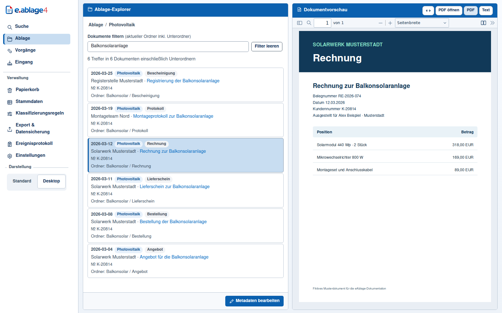
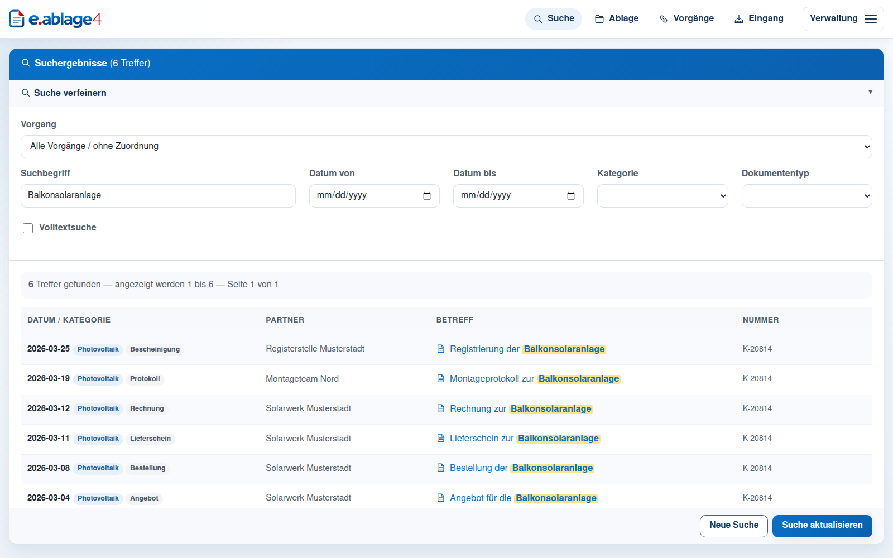
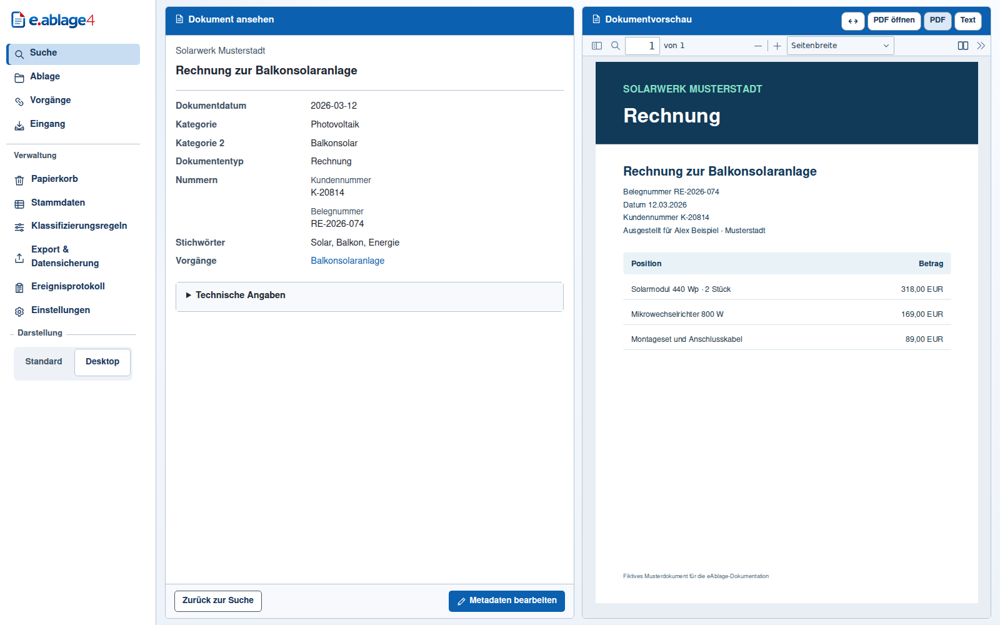
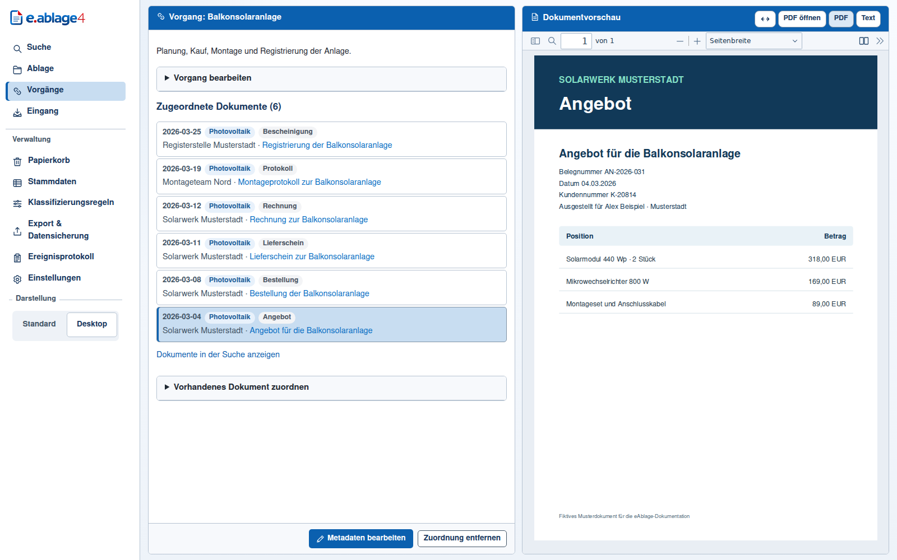
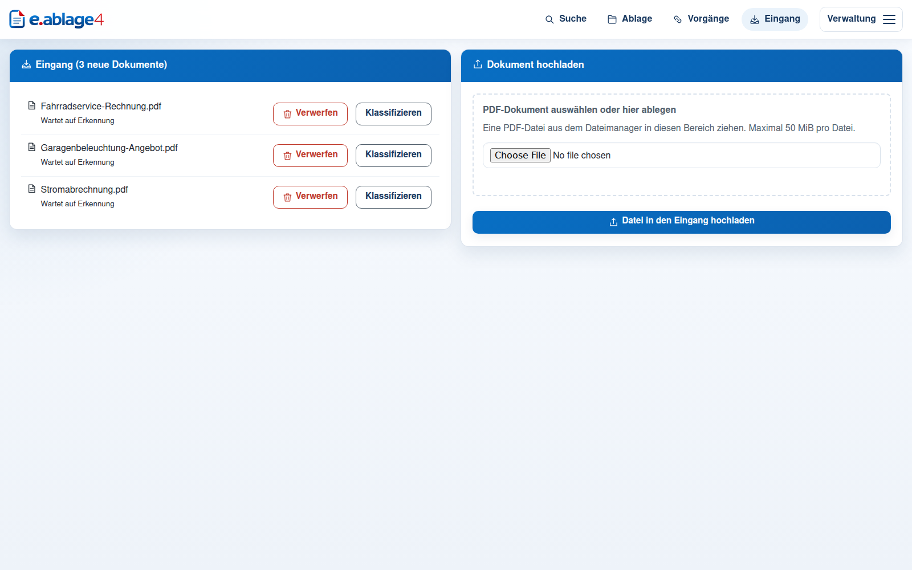
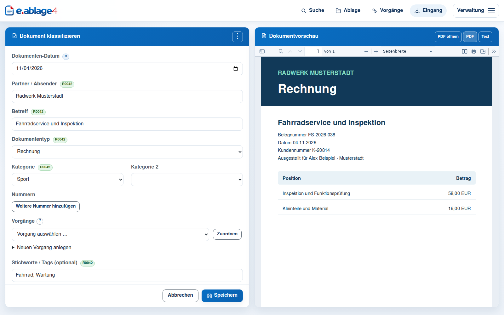

# eAblage in Bildern

Die Screenshots zeigen eAblage 4.6.0 mit fiktiven Dokumenten und Metadaten. Suche, Eingang und Klassifizierung zeigen die Standarddarstellung. Ablage, Dokumentansicht und Vorgänge zeigen den optionalen Desktop-Modus mit Seitenleiste.

## Ablage-Explorer

Die Ablage lässt sich nach Ordnern durchsuchen. Im ausgewählten Ordner findet der Filter auch Dokumente aus Unterordnern. Rechts erscheint die eingebettete PDF.js-Vorschau mit Werkzeugleiste.

## Suche

Die Trefferliste hebt den Suchbegriff hervor. Über den Betreff öffnet sich die Dokumentansicht. Bei Bedarf lässt sich die Suche unter anderem nach Zeitraum, Kategorie und Dokumententyp eingrenzen.

## Dokumentansicht

Neben dem PDF zeigt eAblage die Metadaten, die hinterlegten Nummern und die zugeordneten Vorgänge. Über die Vorschau lässt sich zwischen PDF und Dokumenttext wechseln.

## Vorgänge

Ein Vorgang bündelt zusammengehörige Dokumente. Das Beispiel reicht vom Angebot über Bestellung und Rechnung bis zur Registrierung der Balkonsolaranlage.

## Dokumenteneingang

Im Eingang stehen neu hinzugefügte PDFs zur Klassifizierung bereit. Weitere PDFs können per Dateiauswahl oder Drag-and-drop hochgeladen werden.

## Klassifizierung

Beim Prüfen eines Dokuments stehen die Metadaten neben der PDF-Vorschau. Die AutoKat-Kennzeichnung zeigt, welche Werte eine Regel vorgeschlagen hat.

